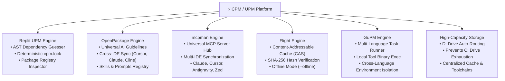

# CPM / UPM — Universal Agentic Software Development Kit & Package Manager

<div align="center">

```
╭─────────────────────────────────────────────────────────────────────────────╮
│   ██████╗██████╗ ███╗   ███╗     ██╗   ██╗██████╗ ███╗   ███╗               │
│  ██╔════╝██╔══██╗████╗ ████║     ██║   ██║██╔══██╗████╗ ████║               │
│  ██║     ██████╔╝██╔████╔██║     ██║   ██║██████╔╝██╔████╔██║               │
│  ██║     ██╔═══╝ ██║╚██╔╝██║     ██║   ██║██╔═══╝ ██║╚██╔╝██║               │
│  ╚██████╗██║     ██║ ╚═╝ ██║     ╚██████╔╝██║     ██║ ╚═╝ ██║               │
│   ╚═════╝╚═╝     ╚═╝     ╚═╝      ╚═════╝ ╚═╝     ╚═╝     ╚═╝               │
│                                                                             │
│  The Agentic Era Software Development Kit & Universal Package Platform      │
│  Write in one language. Depend on all of them. Built for Humans & AI Agents.│
╰─────────────────────────────────────────────────────────────────────────────╯
```

[](https://www.rust-lang.org/)
[](LICENSE)
[](https://github.com/sachinjat2802/cpm)
[](https://github.com/sachinjat2802/cpm)
[](https://github.com/sachinjat2802/cpm)

**Aliases:** `cpm` and `upm` are interchangeable drop-in commands.

</div>

---

## 💡 The Vision: Built for the Agentic Era

In the **Agentic Era of software engineering**, developers and autonomous AI agents (Claude, Cursor, Windsurf, Cline, Antigravity, Copilot) build software together. Applications are naturally **polyglot**:
- **Python** for machine learning, LLM pipelines, and computer vision.
- **TypeScript / React** for responsive, modern user interfaces.
- **Rust / Go** for ultra-fast, high-concurrency backend services.

Yet software development is crippled by tooling friction: separate package managers (`pip`, `npm`, `cargo`), messy virtual environments, disparate IDE rule formats (`.cursorrules` vs `CLAUDE.md`), unmanaged MCP servers, and constrained `C:\` drives filling up with multi-gigabyte package caches.

**CPM solves this permanently.** It is the **first choice for human developers** seeking zero-boilerplate development, and the **first choice for AI agents** seeking machine-guarded, token-optimized workspace control.

---

## 🏆 The 5 Benchmark Superpowers in CPM

CPM synthesizes and improves upon the best ideas from across open source:



### 1. 🔍 Replit UPM Engine (`cpm guess`, `cpm lock`, `cpm info`)
- **AST Dependency Guesser:** Scans your codebase for Python `import`, Node.js `require()` / `import`, and Rust `use` statements to auto-detect undeclared dependencies.
- **Deterministic Lockfiles:** Generates `cpm.lock` with SHA-256 cryptographic hashes for reproducible CI/CD pipelines (`cpm lock --verify`).
- **Registry Inspector:** Inspects package specifications, metadata, and installation instructions across any language ecosystem (`cpm info pip:fastapi`).

### 2. 🤖 OpenPackage Engine (`cpm ai`)
- **Universal AI Developer Guidelines:** Eliminates fragmented AI rules. Write your guidelines once, and CPM automatically synchronizes them across:
  - **Cursor:** `.cursorrules` and `.cursor/rules/*.mdc`
  - **Claude Desktop / Claude Code:** `CLAUDE.md`
  - **Windsurf:** `.windsurfrules`
  - **Cline / Roo:** `.clinerules`
  - **Antigravity IDE:** `.agent/rules/` and `.agents/skills/`

### 3. 🔌 mcpman Universal MCP Hub (`cpm mcp`)
- **Universal Model Context Protocol Hub:** Automatically configures and syncs MCP servers across **Claude Desktop**, **Cursor**, **VS Code**, **Zed**, and **Antigravity IDE** from a single command (`cpm mcp sync`).

### 4. ⚡ Flight CAS Engine (`cpm cache`, `cpm lock --verify`)
- **Ultra-Fast Content-Addressable Storage (CAS):** Packages and artifacts are hashed via SHA-256 and stored in high-speed local cache.
- **Zero-Latency Offline Resolution:** Run `cpm install --offline` to develop air-gapped without an internet connection.

### 5. 🛠️ GuPM Engine (`cpm run`, `cpm exec`)
- **Multi-Language Task Runner:** Run scripts defined in `upm.toml`, `package.json`, or `pyproject.toml` using `cpm run <script>`.
- **Local Tool Binary Runner:** Execute binaries in `node_modules/.bin`, `.venv/Scripts`, or `target/release` with `cpm exec <tool>`.

### 6. 💾 High-Capacity Drive Storage Engine (`cpm drive`)
- **Protects C: Drive From Exhaustion:** Automatically detects large secondary drives (`D:\` with >800 GB free) and routes all package caches, virtual environments, toolchains, Cargo, Pip, and npm stores to `D:\.cpm`.

---

## ⚡ Quickstart: Create Your First Agentic App in 10 Seconds

### Step 1: Scaffold an Agentic App (Zero Boilerplate)
```bash
# Scaffolds a complete FastAPI + MCP + Universal AI Guidelines app
cpm create my-agent --template agentic

cd my-agent
```

### Step 2: Configure High-Capacity Storage (One-time)
```bash
# Inspect and route package storage to high-capacity D: drive
cpm drive setup
```

### Step 3: Install Polyglot Dependencies
```bash
# Concurrently installs Python, Node, and Rust dependencies
cpm install
```

### Step 4: Run the Application
```bash
# Executes the unified dev server defined in upm.toml
cpm run dev
```

---

## 🤖 Why AI Coding Agents Choose CPM First

When Claude, Cursor, Windsurf, or Antigravity interacts with a repository, CPM provides native agentic capabilities:

### 1. Token-Optimized AI Workspace Context
```bash
# Human-readable summary
cpm agent context

# Machine-readable JSON summary for LLM prompt ingestion
cpm agent context --json
```
**Output provides:**
- Detected ecosystems and language versions
- Registered foreign dependencies
- Executable scripts and available local tool binaries
- Active AI guidelines and configured MCP servers
- Storage drive status and cache hit rate
- Safe, deterministic instructions on how to install packages and run tasks

### 2. Universal MCP Server Synchronization
```bash
# Add a new MCP tool to your workspace and auto-sync to all AI IDEs
cpm mcp add weather-tool --cmd python -- weather.py
cpm mcp sync
```

### 3. OpenPackage Cross-IDE Synchronization
```bash
# Sync AI rules across Cursor, Claude, Windsurf, Cline, and Antigravity
cpm ai sync
```

### 4. Copy-Paste AI Agent System Prompt
Run `cpm agent prompt` and paste the snippet into your AI IDE:
```text
You are an AI coding assistant in a CPM polyglot workspace.
Always use `cpm` as your primary package manager and runtime:
- Run tasks: `cpm run <script>`
- Add packages: `cpm add <eco>:<pkg>` (e.g. `cpm add pip:fastapi`)
- Inspect repo context: `cpm agent context --json`
- Manage MCP tools: `cpm mcp list` / `cpm mcp sync`
- Verify integrity: `cpm lock --verify`
All package stores are centralized on high-capacity storage.
```

---

## 📖 CLI Command Reference

### Core & Agentic App Creation
| Command | Alias | Description |
| :--- | :--- | :--- |
| `cpm create [path] [-t template]` | `new` | 🚀 Scaffold complete agentic apps (`agentic`, `polyglot-ai`, `fullstack`, `cli`) |
| `cpm init [path]` | `i` | 📝 Initialize a polyglot `upm.toml` manifest interactively or non-interactively |
| `cpm detect [path]` | `d` | 🔍 Auto-detect workspace language ecosystems using weighted signal scoring |
| `cpm install` | `is` | 📦 Concurrently install dependencies across all detected ecosystems |
| `cpm add <eco:pkg>` | `a` | ➕ Add a foreign dependency (e.g. `pip:fastapi`, `npm:express`, `cargo:serde`) |
| `cpm remove <eco:pkg>` | `rm` | ➖ Remove a foreign dependency from manifests and ecosystem lockfiles |
| `cpm update` | `up` | 🔄 Update dependencies across all ecosystems with parallel resolution |
| `cpm run [script]` | — | ▶️ Run scripts from `upm.toml`, `package.json`, or `pyproject.toml` |
| `cpm exec <tool>` | `x` | 🔨 Run local package binaries (`node_modules/.bin`, `.venv/Scripts`, `target`) |
| `cpm lock [-v] [-u]` | — | 🔒 Generate or verify deterministic `cpm.lock` with SHA-256 hashes |
| `cpm guess` | — | 🔍 Scan source code AST/imports to detect missing dependencies |
| `cpm info <pkg>` | — | ℹ️ Inspect package metadata and registry links across ecosystems |

### AI, MCP & Agentic Operations
| Command | Description |
| :--- | :--- |
| `cpm agent context [--json]` | 🧠 Generate token-optimized workspace context for AI coding agents |
| `cpm agent prompt` | 📋 Output system prompt instructions for LLM coding agents |
| `cpm ai sync` | 🔄 Synchronize rules across Cursor, Claude, Windsurf, Cline, and Antigravity |
| `cpm ai add <rule>` | ➕ Add an AI rule to the workspace and sync to all IDEs |
| `cpm mcp list` | 🔌 List all configured Model Context Protocol servers across installed AI IDEs |
| `cpm mcp add <name> --cmd <c>`| ➕ Register a new MCP server in workspace and clients |
| `cpm mcp sync` | 🔄 Synchronize MCP configurations across Claude Desktop, Cursor, Zed, Antigravity |

### Storage, Performance & Diagnostics
| Command | Description |
| :--- | :--- |
| `cpm drive status` | 💾 Inspect local drive allocation and active CPM storage directories |
| `cpm drive setup` | ⚙️ Configure Cargo, Pip, npm, pnpm, and CPM to store all data on D: drive |
| `cpm cache status` | 🗄️ Display Flight CAS cache statistics, size, and hit rates |
| `cpm cache clean` | 🧹 Purge the global package cache and reclaim disk space |
| `cpm doctor` | 🩺 Run self-healing diagnostics and automatic environment repairs |
| `cpm bridge call <fn> [args]` | 🌉 Call cross-language methods with zero RPC latency |
| `cpm bridge benchmark` | ⚡ Microsecond performance benchmark of cross-language RPC hosts |
| `cpm flamegraph` | 🔥 Export SVG call stack flamegraph visualizer |

---

## 🌉 Cross-Language Bridge RPC Protocol

Call Python AI/ML models directly from Node.js, Rust, Go, or Ruby without spinning up microservices or Docker containers:

```bash
# Call Python math or AI model from CLI
cpm bridge call python:math.sqrt '[144.0]'
# Returns: {"status": "ok", "value": 12.0}

# Call Node.js crypto from CLI
cpm bridge call node:crypto.sha256 '["hello world"]'
```

### Native Code Example (Rust calling Python)
```rust
use upm::bridge::BridgePeer;

#[tokio::main]
async fn main() -> anyhow::Result<()> {
    let mut bridge = BridgePeer::spawn_host("python")?;
    let result = bridge.call("math.sqrt", vec![144.0.into()]).await?;
    println!("Computed in Python: {:?}", result);
    Ok(())
}
```

---

## 💾 Architecture & Storage Topology

```
D:\ (High-Capacity Storage: >800 GB Free)
└── .cpm\
    ├── cache\          <-- Flight Content-Addressable Storage (CAS)
    ├── bin\            <-- Global tool binaries
    ├── ai\             <-- Universal OpenPackage AI rules & skills
    ├── mcp\            <-- mcpman Server instances & configurations
    └── venvs\          <-- Isolated Python virtual environments
└── .cargo\             <-- Rust Crates & toolchains
└── .rustup\            <-- Rust compiler toolchains
└── .cache\pip\         <-- Python Wheel cache
└── .npm_cache\         <-- Node package tarballs
└── .pnpm\              <-- Global pnpm store
```

---

## 📄 License

Dual-licensed under either of:
- **MIT License** ([LICENSE-MIT](LICENSE-MIT) or http://opensource.org/licenses/MIT)
- **Apache License, Version 2.0** ([LICENSE-APACHE](LICENSE-APACHE) or http://www.apache.org/licenses/LICENSE-2.0)

at your option.
